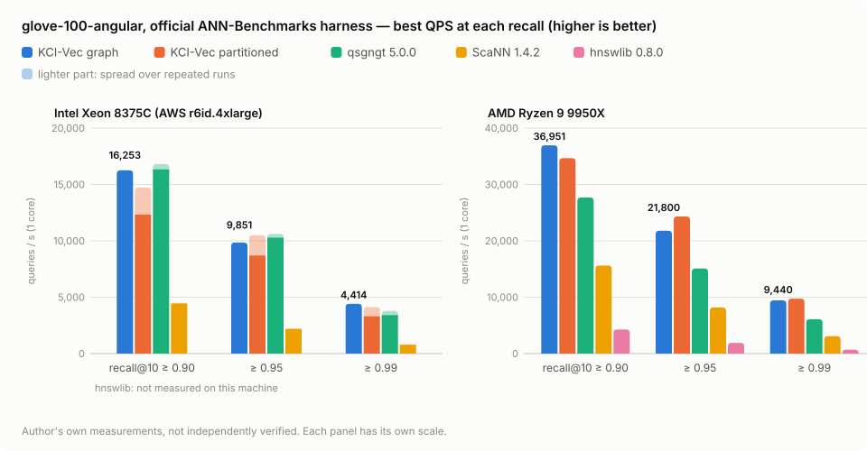

# KCI-Vec

**Embedded vector search, encrypted at rest.**
One in-process library — no server, no dependencies — from a laptop to a Xeon.

*[日本語](README_ja.md)* · **Overview page:** <https://claude.ai/artifact/CCvYMLaDGKzNeFKUBGR69A>

This repository hosts the **evaluation build**: a Python wheel for Linux x86-64, for cosine similarity and Euclidean (L2) distance.

---

## At a glance

| | |
|---|---|
| **Embedded** | Runs inside your process. No server, no JVM, nothing to operate |
| **Encrypted at rest** | Saved indexes are encrypted (AES-256-CTR) and authenticated (AES-256-CMAC). Wrong keys and tampered files are refused. Search runs at full speed |
| **Compact** | One byte per dimension — about a quarter of float32 |
| **Fast** | On the official ANN-Benchmarks harness, roughly 2–5× ScaNN 1.4.2, and on par with or ahead of qsgngt on the same machines |
| **Updatable** | Insert, delete and compact after the build. Metadata filtering. Hybrid keyword + vector ranking |

Built for search over data that must not leave the machine: on-device and desktop apps, in-house systems in regulated
industries, single-tenant services — and anyone who would rather not run a vector database just to search.

---

## Speed

glove-100-angular (1.18 M × 100), official ANN-Benchmarks harness: k = 10, one CPU core, 10,000 queries, best of 5 runs
per setting. Best QPS at recall@10 ≥ 0.90 / 0.95 / 0.99.

<picture>
  <source media="(prefers-color-scheme: dark)" srcset="docs/img/glove100_qps_en_dark.svg">
  
</picture>

| algorithm | Intel Xeon 8375C (AWS r6id.4xlarge) | AMD Ryzen 9 9950X |
|---|---|---|
| **KCI-Vec — graph** (compact layout, preview) | **16,253 / 9,851 / 4,414** | **36,951 / 21,800 / 9,440** |
| **KCI-Vec — partitioned** | 12,331–14,725 / 8,694–10,493 / 3,302–4,138 | 34,670 / 24,321 / 9,747 |
| qsgngt 5.0.0 (full official config) | 16,339–16,809 / 10,282–10,618 / 3,408–3,789 | 27,678 / 15,089 / 6,099 |
| ScaNN 1.4.2 (full official config) | 4,438–4,508 / 2,190–2,219 / 783–794 | 15,611 / 8,195 / 3,085 |
| hnswlib 0.8.0 | — | 4,268 / 1,898 / 685 |

- Ranges are min–max over repeated runs on the same machine: six runs for KCI-Vec partitioned and ScaNN, three for qsgngt, one otherwise.
- **All figures are the author's own measurements and have not been independently verified.** They are not compared
  with the figures on ann-benchmarks.com, which were taken at another time on other machines.
- Rankings depend on the CPU and the recall target; treat these as specific measurements, not a general ranking.

### Speed with Euclidean (L2) distance

sift-128-euclidean (1 M × 128), same harness and conditions, AMD Ryzen 9 9950X, wheel 0.2.0. Best QPS at
recall@10 ≥ 0.90 / 0.95 / 0.99.

| algorithm | AMD Ryzen 9 9950X |
|---|---|
| **KCI-Vec — partitioned** | **53,001 / 40,297 / 20,155** |
| **KCI-Vec — graph** (compact layout, preview) | 51,332 / 39,317 / 12,971 |
| ScaNN 1.4.2 (full official config) | 23,563 / 16,494 / 8,504 |
| hnswlib 0.8.0 (full official config) | 20,294 / 13,807 / 6,502 |

- One run each, the author's own measurements, not independently verified.
- The graph's 0.99 figure comes from settings added after the first run (which stopped at recall 0.98).
- qsgngt is not listed: its binary distribution did not produce results on this dataset in our environment.
- sift-128 vectors have similar lengths; data with widely differing lengths needs more work for the same recall (see Limitations).

---

## Two index types

- **Graph** — links each vector to its nearest neighbours and walks towards the query. Takes inserts and deletes; the
  compact layout (preview) gives the top figures above.
- **Partitioned** — groups the vectors and scans only the groups nearest to the query. No graph to build.

Both support encrypted save / load, metadata filtering and float re-ranking.

---

## Install

```sh
pip install https://github.com/KimYuki3/kci-vec-dist/releases/download/v0.2.1/kci_vec-0.2.1-py3-none-manylinux_2_35_x86_64.whl
```

Requirements: Linux x86-64 with glibc 2.35 or later (e.g. Ubuntu 22.04+, Debian 12+), a CPU with AVX2 (AVX-512 is
used when present), Python 3.8+, NumPy.

sha256 of the wheel: `a52a20af54e99e3a6d4217e38db1b24155e8072e7582432538b17927c3922f33`

---

## Quick start

```python
import numpy as np
from kci_vec import KciVec

v = KciVec(dim=384, rerank=200)            # keep the float vectors for re-ranking
v.add_many(range(len(embeddings)), embeddings)
v.build_lists()                            # partitioned index (v.build() for the graph)

for doc_id, score in v.search(query, k=10):
    ...

allowed = {3, 17, 42}
hits = v.search(query, k=10, filter=lambda i: i in allowed)   # metadata / access control

v.save("index.kv", key=b"a long secret")   # encrypted at rest
v2 = KciVec.load("index.kv", key=b"a long secret")
```

Scores are cosine similarities, highest first. For many queries at once, `v.search_many(queries, k=10)` returns
`(ids, scores)` arrays.

### Euclidean (L2) distance

New in 0.2.0. Pass `metric="l2"`; the vectors keep their length (they are not normalized), and both index types,
filtering and encrypted save / load work as for cosine.

```python
v = KciVec(dim=128, rerank=200, metric="l2")
v.add_many(range(len(vectors)), vectors)
v.build_lists()                            # or v.build() for the graph

for doc_id, dist2 in v.search(query, k=10):   # squared distance |q - x|^2, smallest first
    ...
```

The method that maps Euclidean distance onto the cosine index is patent pending
(Japanese Patent Application No. 2026-241178). This notice covers that method only.

---

## Limitations of the evaluation build

- Linux x86-64 only. Cosine similarity and Euclidean (L2) distance; inner product is not supported.
- L2: when vector lengths differ widely (more than about 4×), the partitioned index needs a larger `nprobe` /
  `rerank_n` than a cosine index for the same recall.
- The compact graph layout is a preview: it is not saved yet, and an insert drops it until it is rebuilt.
- One writer at a time: do not modify an index while searching it.
- During a build the float vectors are held in memory; an SSD-resident index is not available.

---

## License

Free for research, educational, personal and other non-commercial use; commercial use requires a separate license.
See [LICENSE](LICENSE). © 2026 Yukihiro Kimura.

**Contact** — questions, bug reports and commercial licensing: open an issue in this repository
([KimYuki3/kci-vec-dist](https://github.com/KimYuki3/kci-vec-dist/issues)). Issues are public; for a commercial inquiry,
a one-line issue is enough and a private channel will be arranged from there.
