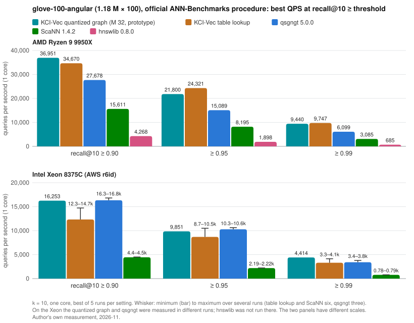

# KCI-Vec

A vector search library that runs inside your own app. It finds the closest matches by meaning among your documents
or images. There is no search server to run, the data does not leave your machine, and the saved files can be encrypted.

> This repository holds the packages (Python wheels for Linux x86-64, Windows x86-64 and macOS). The wheel is attached to the [releases](https://github.com/KimYuki3/kci-vec-dist/releases) (latest: [v0.2.19](https://github.com/KimYuki3/kci-vec-dist/releases/tag/v0.2.19); the sha256 of each file is in the release notes). The source is in [kci-vec-src](https://github.com/KimYuki3/kci-vec-src).

*[日本語](README_ja.md)*

| | |
|---|---|
| Form | One C file (`kci_vec.c` + `kci_vec.h`), no dependencies. Callable from Python |
| Where it fits | In-house systems, on-device software, search shipped inside a product: places where the data cannot go to an outside service |
| Size it is meant for | Tens of thousands to a few million items. The search runs on one byte per dimension. By default the float vectors are kept beside them, to score the best candidates exactly; with `rerank=0` only the bytes are kept, about a quarter of the memory of float, at a lower recall |
| Current version | 0.2.19 (2026-11-28). Changes per version: the [releases page](https://github.com/KimYuki3/kci-vec-dist/releases). The evaluation package (wheel) is in [kci-vec-dist](https://github.com/KimYuki3/kci-vec-dist) |
| Stage | Research stage. Every figure was measured by the developer; none has been confirmed by a third party yet |

## The first ten minutes: put texts in, ask a question

A plain-language explainer of how vector search works, without formulas (in Japanese): ["Where does vector search spend its time?"](https://claude.ai/artifact/ConVBGLKGL9sK5XjJLDvfY).

No knowledge of vectors or models is needed to start. Hand over texts; they are turned into vectors and indexed inside.

```python
from kci_vec.text import TextIndex

ix = TextIndex("en", sparse="bm25")
ix.add([
    "Paid leave: 10 days are granted after six months of service. Apply three business days ahead.",
    "Expense reports close at the end of the month. Hand the original receipts to general affairs.",
    "If you forget your password, call the IT desk at extension 1234.",
])
for hit in ix.search("how many days of paid leave do I get?", k=2):
    print(hit.id, round(hit.score, 3), hit.text)

ix.save("my_index", key="your passphrase")   # the index and the texts, encrypted
```

The steps from installing to indexing your own files, saving, opening again and asking are in
**[docs/quickstart_text.md](https://github.com/KimYuki3/kci-vec-src/blob/main/docs/quickstart_text.md)** (typed top to bottom in a fresh environment).
This layer (`kci_vec.text`) is experimental. With the language models it has been run on Linux only; on Windows and macOS only its model-free setting (`mode="sparse", sparse="bm25"`) has been run.

Bringing your own vectors: see "Usage" below.

## What it does

| | In a line | Stage |
|---|---|---|
| Nearest vectors | Cosine, Euclidean (L2), inner product. Two structures: a graph that is walked, and partitions that are scanned | stable |
| Insert, delete, compact after the build | Both structures | stable |
| Filtered search | By attribute or permission, applied during the search (not cut afterwards) | stable |
| Encrypted saves | AES-256-CTR; tampering detected with CMAC; a wrong key or a damaged file is refused | stable |
| Search by handing over texts | `kci_vec.text`. Long texts are split automatically. Built-in default models for Japanese and English | experimental |
| Together with word matching | Meaning plus words (BM25 or a sparse model), so part numbers, names and abbreviations are not lost | experimental |
| A hook for your re-ranker | Take the candidates out and hand them to a re-ranking model of your own | experimental |
| Identical vectors kept once | For data where the same text is stored many times (`kci_vec_set_dedup`) | stable |
| From PostgreSQL | The extension in `pg/`, called through SQL functions | prototype |
| One index shared by several processes | A read-only image opened with mmap | stable |

The families: the graph is HNSW; the partitions use 4-bit codes and table lookup, as ScaNN and faiss fast-scan do.

## Where it does not fit, and the limits

Stated first. If one of these is you, another tool will suit better.

- **You want the operation taken care of.** KCI-Vec is a component. There is no elastic server, no distribution over several machines, no console.
- **The data does not fit in memory.** The index is searched in memory. There is no on-SSD search (DiskANN-style) yet.
- **You want answers written for you.** It returns the closest items. The model that writes an answer is separate.
- One writer at a time. To change the index while it is searched, go through the Python layer or the PostgreSQL extension.
- The quantized graph (the faster form of the graph) has to be rebuilt after inserts.
- L2 and inner-product indexes get coarse when a few vectors are far longer than the rest. They suit data of even lengths.
- Data with many identical vectors lowers the graph's recall as it is. Use `kci_vec_set_dedup` (since 0.2.8).
- Files saved from an index with `kci_vec_set_dedup`, or with the memory-first quantized graph (`kci_vec_build_qg_res`), cannot be read by versions up to 0.2.7 (they refuse them).
- ARM runs mostly the portable C path and is slower than x86.
- The distributed Python packages (wheels, from 0.2.16): Linux x86-64 (AVX2, AVX-512 where present), Windows x86-64 (AVX2) and macOS (Apple silicon; Intel Macs with AVX2, 2013 and later). The Windows and Intel-Mac packages carry the AVX2 build only. An Intel Mac without AVX2 is not checked for and will crash. The macOS packages were built and tested on hosted build machines, not on a Mac of the author's.

## Measured results

**All measured by the developer.** Competitors use their official configurations; the KCI-Vec settings include ones
chosen while looking at results. The order changes with the data, the dimension and the machine.

glove-100 (1.18 M × 100), the official ANN-Benchmarks harness, one core, best QPS at recall@10 ≥ 0.90 / 0.95 / 0.99:

| | Intel Xeon 8375C | AMD Ryzen 9 9950X |
|---|---|---|
| KCI-Vec graph | 16,253 / 9,851 / 4,414 | 36,951 / 21,800 / 9,440 |
| KCI-Vec partitions | 12,331–14,725 / 8,694–10,493 / 3,302–4,138 | 34,670 / 24,321 / 9,747 |
| qsgngt 5.0.0 | 16,339–16,809 / 10,282–10,618 / 3,408–3,789 | 27,678 / 15,089 / 6,099 |
| ScaNN 1.4.2 | 4,438–4,508 / 2,190–2,219 / 783–794 | 15,611 / 8,195 / 3,085 |



The VIBE flow (a benchmark on data from current embedding models), k = 100, one core, 9950X, best QPS at recall@100 ≥ 0.90 / 0.95 / 0.99
(KCI-Vec 0.2.5; glass measured on the same machine on 2026-11-19):

| | yahoo (cosine, 384 dims) | agnews (L2, 1024 dims) |
|---|---|---|
| KCI-Vec graph | 21,294 / 18,197 / 12,139 | 13,619 / 9,649 / 5,982 |
| glass | 14,860 / 11,892 / 8,874 | 9,877 / 7,378 / 4,961 |

- On the Xeon with glove-100 it is level with or slightly below qsgngt at 0.90 and 0.95, and above at 0.99.
- The agnews figures are from 0.2.3 on. Up to 0.2.2 it was behind glass from 0.95 up.
- The KCI-Vec index is larger than glass on these two datasets (at the points above, yahoo: 4.9–5.0 GB against 0.7–0.8 GB; agnews: 5.0–7.4 GB against 2.5–3.6 GB).
  A memory-first form was added in 0.2.8 (not yet measured in the VIBE flow).
- There are places it does not reach: on glove-200, for example, neither method reached recall 0.99.
- The comparison with pgvector inside PostgreSQL is under "From PostgreSQL" below.
- Leaderboards: submitted to VIBE ([PR #21](https://github.com/vector-index-bench/vibe/pull/21)), no reply yet. ANN-Benchmarks is no longer maintained, so the submission there was withdrawn.

## Usage

### Install

```sh
# Python (Linux x86-64, Windows x86-64, macOS): the distributed package
pip install kci-vec

# From source
sh build_kci_vec.sh          # libkci_vec.{so|dylib} and example_kci_vec   (Linux / macOS)
# Windows: gcc -O3 -march=native -shared -static -static-libgcc -o libkci_vec.dll kci_vec.c
# Python:  pip install ./clients/python
```

### Python (your own vectors)

```python
from kci_vec import KciVec

v = KciVec(dim=384, rerank=200)          # L2: metric="l2"; inner product: metric="ip"
v.add_many(ids, embeddings)              # float32 [n, dim]
v.build_lists()                          # the partitions (v.build() for the graph)
for doc_id, score in v.search(query_vec, k=5):
    ...
hits = v.search(query_vec, k=5, filter=allowed_ids)   # filtered
v.save("index.kv", key=b"secret")        # encrypted
```

### C

```c
KciVec *v = kci_vec_new(dim, /*M*/16, /*efc*/200);      // L2: kci_vec_new_l2; inner product: kci_vec_new_ip
kci_vec_add(v, id, float_vec);
kci_vec_build(v, /*threads*/0, &secs);                   // build the graph (0 = all cores)
kci_vec_search(v, query, k, /*ef*/100, out_ids, out_scores);
kci_vec_save(v, "index.kv", key, keylen);                // encrypted if a key is given (NULL = plaintext)
KciVec *v2 = kci_vec_load("index.kv", key, keylen);
kci_vec_free(v);
```

For speed, create one `KciVecSearcher` per thread and reuse it. The whole flow is in `example_kci_vec.c`; every
function is described above its declaration in `kci_vec.h`.

### From PostgreSQL (the extension in `pg/`, a prototype)

```sql
SELECT kci_vec_build('docs', 'docs', 'id', 'embedding');            -- build from the table docs(id, embedding)
SELECT kci_vec_track('docs');                                        -- follow INSERT / UPDATE / DELETE from now on
SELECT id, score FROM kci_vec_search('docs', '[0.1, ...]'::vector, 10);
```

- The server, permissions, backup and replication are PostgreSQL's own. Changes to the table show up in searches at once.
- Cosine, L2 and inner product. Tested on PostgreSQL 15 / 16 / 17.
- Not pgvector's syntax: functions, not `CREATE INDEX` and `<=>`.
- For a PostgreSQL you manage yourself. Managed services that do not let you install extensions cannot use it.
- The extension's index files are not encrypted for now (use disk encryption with it).

Against pgvector 0.8.1 (HNSW, m 16, ef_construction 200) on the same machine, the same table and the same SQL
round trip (glove-100, 1.18 M rows, one connection, k = 10, three alternating rounds, Ryzen 7 8845HS, PostgreSQL 16, 2026-11-20):

| | recall@10 | queries/s |
|---|---|---|
| KCI-Vec | 0.9005 | 3,261–3,906 |
| pgvector (ef_search 240) | 0.8947 | 199–210 |
| KCI-Vec | 0.9632 | 1,776–2,206 |
| pgvector (ef_search 1000, the maximum) | 0.9612 | 58–59 |

One dataset, one machine. Concurrent connections and filtered search were not measured. Usage and limits: `pg/README.md`.

## Encryption and checks

- Standard primitives only: AES-256-CTR, AES-256-CMAC, keys from PBKDF2-HMAC-SHA256 with a salt per save.
  AES and CMAC are checked against the known answers of FIPS-197 and SP 800-38B.
- Decryption happens only at load, so searching is as fast as without encryption.
- A wrong key, a damaged file or an altered file is not loaded. Saves go through a temporary file and a rename, so a crash midway leaves the old file intact.
- Checks: hostile inputs and 32 concurrent threads with zero ASan / UBSan reports.

## Source

The C source, the Python client, the PostgreSQL extension, the tests and the guides are in [kci-vec-src](https://github.com/KimYuki3/kci-vec-src).

## License

[MIT](LICENSE), from version 0.2.15: free to use, modify and distribute, including in commercial products.
Versions up to 0.2.14 were released under PolyForm Noncommercial 1.0.0 and stay under it.

Copyright (c) 2026 Yukihiro Kimura (https://github.com/KimYuki3)

The method that maps Euclidean distance onto the cosine index is patent pending
