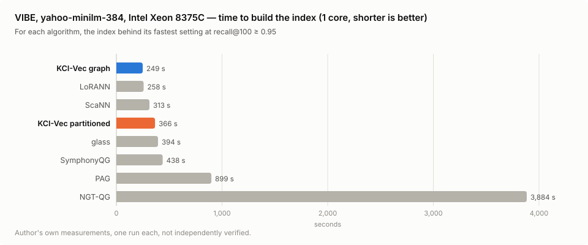
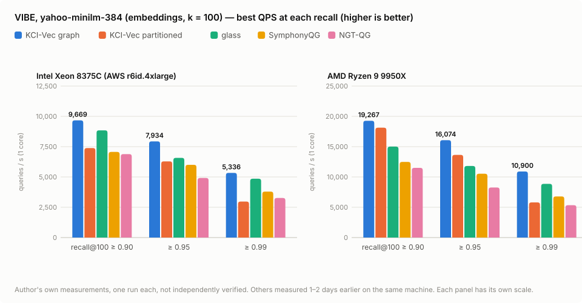

# KCI-Vec

**Fast, compact vector search you embed in your application.**
One in-process library — no server, no dependencies — from a laptop to a Xeon. Saved indexes can be encrypted when you need it.

*[日本語](README_ja.md)* · **Overview page:** <https://claude.ai/artifact/CCvYMLaDGKzNeFKUBGR69A>

This repository hosts the **evaluation build**: a Python wheel for Linux x86-64, for cosine similarity and Euclidean (L2) distance.

**Download:** the wheel is attached to each release, not stored in the file list — **[Releases](https://github.com/KimYuki3/kci-vec-dist/releases)** (latest: [v0.2.1](https://github.com/KimYuki3/kci-vec-dist/releases/tag/v0.2.1)). Install it with the `pip install` line under *Install* below.

---

## At a glance

| | |
|---|---|
| **Embedded** | Runs inside your process. No server, no JVM, nothing to operate |
| **Fast** | On the official ANN-Benchmarks harness, roughly 2–5× ScaNN 1.4.2, and on par with or ahead of qsgngt on the same machines |
| **Compact** | One byte per dimension — about a quarter of float32 |
| **Updatable** | Insert, delete and compact after the build |
| **Flexible queries** | Metadata / permission filtering, hybrid keyword + vector ranking |
| **Encryption if you need it** | Saved indexes can be encrypted (AES-256-CTR) and authenticated (AES-256-CMAC). Optional; costs nothing when unused |

Made for applications that need vector search without running a vector database: shipped inside an app, on a device,
or over data that should not leave the machine.

---

## What you can use it for

| Use | Example | What makes it fit |
|---|---|---|
| **Search inside an application** | Search notes, mail or files by meaning in a desktop or on-device app | No server; it runs in your process. About a quarter of float32's memory |
| **Search that also needs exact words** | Queries with part numbers, names or figures that meaning alone misses | Keyword and vector ranking combined |
| **Search that respects permissions** | Show only the documents a department or role may see | Filtering by a condition on the id |
| **Search and RAG over in-house documents** | Find internal rules, manuals or support history by meaning before an AI answers from them | Nothing has to go to an outside service. The index can be encrypted, with tampering detected |
| **One index per customer** | In a service, give each customer their own index file | An index is one file; if needed, each customer's can be encrypted with its own key |
| **Comparing methods, research** | Measure speed against other libraries on the same harness | The wheel installs with pip, without the sources; an ANN-Benchmarks component is proposed in [erikbern/ann-benchmarks#643](https://github.com/erikbern/ann-benchmarks/pull/643) |

What the evaluation build does not cover (platforms, update model, license) is listed under
*Limitations of the evaluation build* and *License* below.

---

## Compared with other products

All figures are the author's own measurements and have not been independently verified. Conditions are under *Speed* below.

**Compared with vector databases that run as a server**
- **Nothing to operate**: a search is a function call inside your process. No server to start, monitor, upgrade or network.
- **Ships with your application**: one wheel (one library inside), one file per index.
- **No network round trip** per query (a difference in design; not measured here).

**Compared with embedded libraries (ScaNN, hnswlib, …)**
- **Faster**: on the same machines with the same official harness, 2.2–5.3× ScaNN 1.4.2 (partitioned index) and
  8.7–13.8× hnswlib 0.8.0 (graph index; 9950X, hnswlib with a reduced grid) on glove-100 (cosine); 2.2–2.4× ScaNN and
  2.6–3.1× hnswlib on sift-128 (L2, partitioned index).
- **Smaller**: one byte per dimension (int8), about a quarter of an index held in float32.
- **All in one**: insert / delete / compact after the build, metadata filtering, keyword (BM25) + vector ranking, and
  encrypted, authenticated saves — without combining separate components.

**Compared with other quantized-graph methods (qsgngt, glass, SymphonyQG, NGT-QG)**
- **glove-100**: against qsgngt, 1–7 % behind at recall 0.90 and 0.95 and 1.16–1.30× at 0.99 on the Xeon; 1.34–1.55× on the 9950X.
- **VIBE, the embedding benchmark (yahoo-minilm-384, k = 100)**: 1.09–1.36× glass, 1.3–1.6× SymphonyQG, 1.4–2.0× NGT-QG
  (Xeon and 9950X; the others measured a day or two before on the same machines).
- **Faster to build**: on one core, about a seventh of qsgngt's build time on glove-100 (1,867 s vs 13,051 s, partitioned
  index, Xeon), and under a quarter of NGT-QG's on VIBE yahoo (249–458 s vs 1,894–3,884 s,
  graph index, Xeon, best-point indexes on both sides).

<picture>
  <source media="(prefers-color-scheme: dark)" srcset="docs/img/vibe_build_en_dark.svg">
  
</picture>

**Where it is weaker**
- The graph index (compact layout) is large: 3.3–4.3× glass's memory on VIBE yahoo (best-point indexes).
- On 1024-dimensional L2 data (VIBE agnews), it does not reach glass from recall 0.95 up.
- The evaluation build is Linux x86-64 only.

---

## Speed

glove-100-angular (1.18 M × 100), official ANN-Benchmarks harness: k = 10, one CPU core, 10,000 queries, best of 5 runs
per setting. Best QPS at recall@10 ≥ 0.90 / 0.95 / 0.99.

<picture>
  <source media="(prefers-color-scheme: dark)" srcset="docs/img/glove100_qps_en_dark.svg">
  
</picture>

| algorithm | Intel Xeon 8375C (AWS r6id.4xlarge) | AMD Ryzen 9 9950X |
|---|---|---|
| **KCI-Vec — graph** (compact layout, preview) | **16,253 / 9,851 / 4,414** | **36,951 / 21,800 / 9,440** |
| **KCI-Vec — partitioned** | 12,331–14,725 / 8,694–10,493 / 3,302–4,138 | 34,670 / 24,321 / 9,747 |
| qsgngt 5.0.0 (full official config) | 16,339–16,809 / 10,282–10,618 / 3,408–3,789 | 27,678 / 15,089 / 6,099 |
| ScaNN 1.4.2 (full official config) | 4,438–4,508 / 2,190–2,219 / 783–794 | 15,611 / 8,195 / 3,085 |
| hnswlib 0.8.0 | — | 4,268 / 1,898 / 685 |

- Ranges are min–max over repeated runs on the same machine: six runs for KCI-Vec partitioned and ScaNN, three for qsgngt, one otherwise.
- **All figures are the author's own measurements and have not been independently verified.** They are not compared
  with the figures on ann-benchmarks.com, which were taken at another time on other machines.
- Rankings depend on the CPU and the recall target; treat these as specific measurements, not a general ranking.

### Speed with Euclidean (L2) distance

sift-128-euclidean (1 M × 128), same harness and conditions, AMD Ryzen 9 9950X, wheel 0.2.0. Best QPS at
recall@10 ≥ 0.90 / 0.95 / 0.99.

| algorithm | AMD Ryzen 9 9950X |
|---|---|
| **KCI-Vec — partitioned** | **53,001 / 40,297 / 20,155** |
| **KCI-Vec — graph** (compact layout, preview) | 51,332 / 39,317 / 12,971 |
| ScaNN 1.4.2 (full official config) | 23,563 / 16,494 / 8,504 |
| hnswlib 0.8.0 (full official config) | 20,294 / 13,807 / 6,502 |

- One run each, the author's own measurements, not independently verified.
- The graph's 0.99 figure comes from settings added after the first run (which stopped at recall 0.98).
- qsgngt is not listed: its binary distribution did not produce results on this dataset in our environment.
- sift-128 vectors have similar lengths; data with widely differing lengths needs more work for the same recall (see Limitations).

### Speed on VIBE, the embedding benchmark

[VIBE](https://github.com/vector-index-bench/vibe), official container flow, yahoo-minilm-384-normalized (677 k × 384,
cosine): k = 100, one core for build and search, best of 5 runs per setting. Best QPS at recall@100 ≥ 0.90 / 0.95 / 0.99.
KCI-Vec is wheel 0.2.1.

<picture>
  <source media="(prefers-color-scheme: dark)" srcset="docs/img/vibe_qps_en_dark.svg">
  
</picture>

| algorithm | Intel Xeon 8375C (AWS r6id.4xlarge) | AMD Ryzen 9 9950X |
|---|---|---|
| **KCI-Vec — graph** (compact layout, preview) | **9,669 / 7,934 / 5,336** | **19,267 / 16,074 / 10,900** |
| **KCI-Vec — partitioned** | 7,383 / 6,287 / 2,969 | 18,126 / 13,642 / 5,802 |
| glass | 8,844 / 6,575 / 4,854 | 15,010 / 11,811 / 8,861 |
| SymphonyQG | 7,066 / 6,001 / 3,789 | 12,476 / 10,527 / 6,784 |
| NGT-QG | 6,887 / 4,916 / 3,266 | 11,497 / 8,256 / 5,339 |
| LoRANN | 6,417 / 3,398 / 1,297 | 16,991 / 8,690 / 3,024 |
| ScaNN | 3,203 / 2,057 / 645 | 10,456 / 6,755 / 2,459 |

- One run each, the author's own measurements. The others ran with VIBE's own grids, on the same machines a day or two
  before KCI-Vec.
- **KCI-Vec's grid was widened after looking at results on this dataset** (two dims per code, int8 re-scoring, ef 220 / 250).
- On 1024-dimensional L2 data (agnews-mxbai-1024-euclidean, 9950X, same day) glass is faster from recall 0.95 up:
  KCI-Vec graph 9,653 / 6,328 / 3,470, glass 9,875 / 7,425 / 4,693.
- Not yet submitted to VIBE. Not compared with the figures on vector-index-bench.github.io (another time, other machines).

---

## Two index types

- **Graph** — links each vector to its nearest neighbours and walks towards the query. Takes inserts and deletes; the
  compact layout (preview) gives the top figures above.
- **Partitioned** — groups the vectors and scans only the groups nearest to the query. No graph to build.

Both support encrypted save / load, metadata filtering and float re-ranking.

---

## Install

```sh
pip install https://github.com/KimYuki3/kci-vec-dist/releases/download/v0.2.1/kci_vec-0.2.1-py3-none-manylinux_2_35_x86_64.whl
```

Requirements: Linux x86-64 with glibc 2.35 or later (e.g. Ubuntu 22.04+, Debian 12+), a CPU with AVX2 (AVX-512 is
used when present), Python 3.8+, NumPy.

sha256 of the wheel: `a52a20af54e99e3a6d4217e38db1b24155e8072e7582432538b17927c3922f33`

---

## Quick start

```python
import numpy as np
from kci_vec import KciVec

v = KciVec(dim=384, rerank=200)            # keep the float vectors for re-ranking
v.add_many(range(len(embeddings)), embeddings)
v.build_lists()                            # partitioned index (v.build() for the graph)

for doc_id, score in v.search(query, k=10):
    ...

allowed = {3, 17, 42}
hits = v.search(query, k=10, filter=lambda i: i in allowed)   # metadata / access control

v.save("index.kv", key=b"a long secret")   # encrypted at rest
v2 = KciVec.load("index.kv", key=b"a long secret")
```

Scores are cosine similarities, highest first. For many queries at once, `v.search_many(queries, k=10)` returns
`(ids, scores)` arrays.

### Euclidean (L2) distance

New in 0.2.0. Pass `metric="l2"`; the vectors keep their length (they are not normalized), and both index types,
filtering and encrypted save / load work as for cosine.

```python
v = KciVec(dim=128, rerank=200, metric="l2")
v.add_many(range(len(vectors)), vectors)
v.build_lists()                            # or v.build() for the graph

for doc_id, dist2 in v.search(query, k=10):   # squared distance |q - x|^2, smallest first
    ...
```

The method that maps Euclidean distance onto the cosine index is patent pending
(Japanese Patent Application No. 2026-241178). This notice covers that method only.

---

## Limitations of the evaluation build

- Linux x86-64 only. Cosine similarity and Euclidean (L2) distance; inner product is not supported.
- L2: when vector lengths differ widely (more than about 4×), the partitioned index needs a larger `nprobe` /
  `rerank_n` than a cosine index for the same recall.
- The compact graph layout is a preview: it is not saved yet, and an insert drops it until it is rebuilt.
- One writer at a time: do not modify an index while searching it.
- During a build the float vectors are held in memory; an SSD-resident index is not available.

---

## License

Free for research, educational, personal and other non-commercial use; commercial use requires a separate license.
See [LICENSE](LICENSE). © 2026 Yukihiro Kimura.

**Contact** — questions, bug reports and commercial licensing: open an issue in this repository
([KimYuki3/kci-vec-dist](https://github.com/KimYuki3/kci-vec-dist/issues)). Issues are public; for a commercial inquiry,
a one-line issue is enough and a private channel will be arranged from there.
