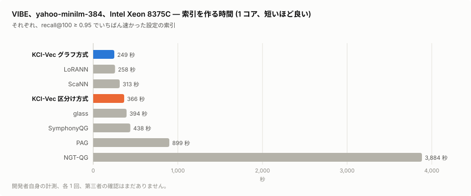
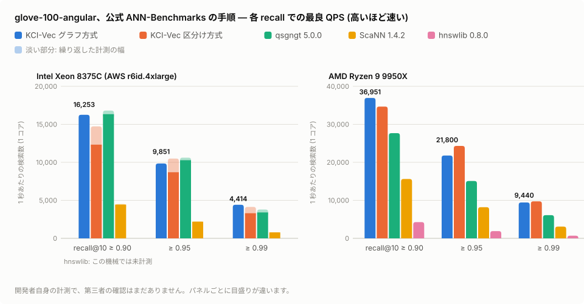
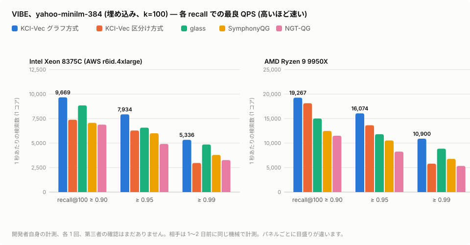

# KCI-Vec

**アプリに組み込む、速くて軽いベクトル検索。**
プロセスの中で動く 1 つのライブラリ。サーバも依存もなく、ノート PC から Xeon まで動きます。必要なら、保存する索引を暗号化することもできます。

*[English](README.md)* · **紹介ページ:** <https://claude.ai/artifact/CCvYMLaDGKzNeFKUBGR69A#ja>

このリポジトリでは **評価用の部品** を配っています。Linux x86-64 用の Python の wheel で、cosine 類似度とユークリッド (L2) 距離に対応しています。

**ダウンロード:** wheel はファイルの一覧ではなく、版ごとの配布の置き場にあります — **[Releases](https://github.com/KimYuki3/kci-vec-dist/releases)** (最新は [v0.2.1](https://github.com/KimYuki3/kci-vec-dist/releases/tag/v0.2.1))。入れ方は下の「入れ方」の `pip install` の 1 行です。

**ソース:** **[KimYuki3/kci-vec-src](https://github.com/KimYuki3/kci-vec-src)** — C のソース (cosine の索引)、Python の包み、ANN-Benchmarks の部品。ライセンスは PolyForm Noncommercial 1.0.0 です。L2 の索引はいまは wheel だけにあり、ソースは後で公開します。

---

## ひと目で

| | |
|---|---|
| **組み込み** | アプリのプロセスの中で動きます。サーバも JVM も、運用の手間もありません |
| **速い** | 公式 ANN-Benchmarks の手順で ScaNN 1.4.2 の約 2〜5 倍。qsgngt とも、同じ機械で並ぶか上回ります |
| **軽い** | 1 次元 1 バイト。float32 の約 4 分の 1 のメモリで動きます |
| **更新できる** | 作ったあとも追加・削除・詰め直しができます |
| **探し方を足せる** | 属性・権限での絞り込み、キーワードとベクトルを合わせた順位付け |
| **暗号化もできる** | 要るときだけ。保存する索引を AES-256-CTR で暗号化し、AES-256-CMAC で改ざんを検出します。使わなければ手間も費用もかかりません |

検索のためだけにベクトル DB を立てて運用したくない場合に向いています。アプリに入れて配る、手元の端末で動かす、データを外に出さずに探す、
といった使い方です。

---

## 利用できる用途

| 用途 | 例 | 生きる性質 |
|---|---|---|
| **アプリの中の検索** | デスクトップや端末のアプリで、メモ・メール・ファイルを意味で探す | サーバが要らず、プロセスの中で動く。メモリは float32 の約 4 分の 1 |
| **言葉の一致も要る検索** | 品番・人名・数字のように、意味だけでは拾えない語を含む問い | キーワードとベクトルを合わせた順位付け |
| **権限に合わせた検索** | 部署や役職で見てよい文書だけを結果に出す | id に対する条件での絞り込み |
| **社内の文書の検索・RAG** | 社内規程や手順書、問い合わせの履歴を、AI に答えさせる前に意味で探す | 外部のサービスに送らずに済む。要るなら索引を暗号化し、改ざんを検出できる |
| **利用者ごとに分けた索引** | サービスで、お客さまごとに索引のファイルを分ける | 索引は 1 つのファイル。要るなら、お客さまごとに別の鍵で暗号化できる |
| **手法の比べ・研究** | ほかのライブラリと同じ手順で速さを比べる | wheel を pip で入れるだけで動く (ソースは [kci-vec-src](https://github.com/KimYuki3/kci-vec-src))。ANN-Benchmarks の部品は [erikbern/ann-benchmarks#643](https://github.com/erikbern/ann-benchmarks/pull/643) で申し込み中 |

評価用の部品で対応していないこと (動く環境、更新の仕方、ライセンス) は、下の「評価用の部品の制限」と「ライセンス」の節にあります。

---

## ほかの製品と比べて

数字はどれも開発者自身の計測で、第三者による確認はまだありません。条件は下の「速さ」の節にあります。

**サーバとして動くベクトル DB と比べて**
- **運用するものが無い**: 検索はプロセスの中の関数呼び出しです。サーバの立ち上げ・監視・更新・ネットワークの設定が要りません。
- **アプリと一緒に配れる**: 部品は 1 つの wheel (中身は 1 つのライブラリ)、索引は 1 つのファイルです。
- **通信の往復が無い**: 質問のたびにネットワークを通りません (仕組みの違いで、ここでは測っていません)。

**組み込みのライブラリ (ScaNN、hnswlib など) と比べて**
- **速い**: 同じ機械・同じ公式の手順で、glove-100 (cosine) では区分け方式で ScaNN 1.4.2 の 2.2〜5.3 倍、グラフ方式で hnswlib 0.8.0 の
  8.7〜13.8 倍 (9950X。hnswlib は設定の組を減らして計測)。sift-128 (L2) では区分け方式で ScaNN の 2.2〜2.4 倍、hnswlib の 2.6〜3.1 倍。
- **メモリが小さい**: ベクトルは 1 次元 1 バイト (int8) で、float32 で持つ索引の約 4 分の 1 です。
- **1 つで揃う**: 作ったあとの追加・削除・詰め直し、属性での絞り込み、キーワード (BM25) との組み合わせ、暗号化と改ざん検出つきの保存を、
  別の部品を組み合わせずに使えます。

**量子化グラフの仲間 (qsgngt、glass、SymphonyQG、NGT-QG) と比べて**
- **glove-100**: qsgngt に対して、Xeon では recall 0.90・0.95 で 1〜7 % 下、0.99 で 1.16〜1.30 倍。9950X では 1.34〜1.55 倍。
- **埋め込みの VIBE (yahoo-minilm-384、k=100)**: glass の 1.09〜1.36 倍、SymphonyQG の 1.3〜1.6 倍、NGT-QG の 1.4〜2.0 倍 (Xeon と 9950X。相手は 1〜2 日前に同じ機械で測った値)。
- **作るのが速い**: 1 コアで索引を作る時間は、glove-100 で qsgngt の約 7 分の 1 (1,867 秒 対 13,051 秒、区分け方式、Xeon)、
  VIBE の yahoo で NGT-QG の 4 分の 1 以下 (249〜458 秒 対 1,894〜3,884 秒、グラフ方式、Xeon、どちらも最良点の索引)。

<picture>
  <source media="(prefers-color-scheme: dark)" srcset="docs/img/vibe_build_ja_dark.svg">
  
</picture>

**弱いところも書いておきます**
- グラフ方式 (詰めた配置) の索引は大きく、VIBE の yahoo では最良点の索引どうしで glass の 3.3〜4.3 倍のメモリを使います。
- 1024 次元の L2 のデータ (VIBE の agnews) では、recall 0.95 から上で glass に届いていません。
- 評価用の部品は Linux x86-64 だけです。

---

## 速さ

glove-100-angular (118 万件 × 100 次元)、公式 ANN-Benchmarks の手順 (k=10、1 コア、質問 1 万、各設定 5 回の最速)。
recall@10 が 0.90 / 0.95 / 0.99 以上での最良 QPS (1 秒あたりの検索数) です。

<picture>
  <source media="(prefers-color-scheme: dark)" srcset="docs/img/glove100_qps_ja_dark.svg">
  
</picture>

| 算法 | Intel Xeon 8375C (AWS r6id.4xlarge) | AMD Ryzen 9 9950X |
|---|---|---|
| **KCI-Vec グラフ方式** (詰めた配置、先行版) | **16,253 / 9,851 / 4,414** | **36,951 / 21,800 / 9,440** |
| **KCI-Vec 区分け方式** | 12,331〜14,725 / 8,694〜10,493 / 3,302〜4,138 | 34,670 / 24,321 / 9,747 |
| qsgngt 5.0.0 (公式の全設定) | 16,339〜16,809 / 10,282〜10,618 / 3,408〜3,789 | 27,678 / 15,089 / 6,099 |
| ScaNN 1.4.2 (公式の全設定) | 4,438〜4,508 / 2,190〜2,219 / 783〜794 | 15,611 / 8,195 / 3,085 |
| hnswlib 0.8.0 | — | 4,268 / 1,898 / 685 |

- 幅のある値は、同じ機械で繰り返した計測の最小〜最大です。KCI-Vec 区分け方式と ScaNN は 6 回、qsgngt は 3 回、それ以外は 1 回です。
- **すべて開発者自身の計測で、第三者による確認はまだありません。** ann-benchmarks.com の数字とは比べていません (時期も機械も違うため)。
- 順位は CPU と目標の recall で変わります。一般的な順位ではなく、特定の条件での計測としてご覧ください。

### ユークリッド (L2) 距離の速さ

sift-128-euclidean (100 万件 × 128 次元)。上と同じ計測の道具と条件で、AMD Ryzen 9 9950X、wheel 0.2.0 です。
recall@10 が 0.90 / 0.95 / 0.99 以上になる設定のうち、いちばん速い QPS です。

| 算法 | AMD Ryzen 9 9950X |
|---|---|
| **KCI-Vec 区分け方式** | **53,001 / 40,297 / 20,155** |
| **KCI-Vec グラフ方式** (詰めた配置、先行版) | 51,332 / 39,317 / 12,971 |
| ScaNN 1.4.2 (公式の全設定) | 23,563 / 16,494 / 8,504 |
| hnswlib 0.8.0 (公式の全設定) | 20,294 / 13,807 / 6,502 |

- どれも 1 回ずつの、開発者自身の計測です。第三者による確認はまだありません。
- グラフ方式の 0.99 の値は、最初の計測 (recall 0.98 まで) のあとに設定を足して計ったものです。
- qsgngt は載せていません。配布されているバイナリが、私たちの環境ではこのデータで結果を出せませんでした。
- sift-128 は長さのそろったデータです。長さが大きく違うデータでは、同じ recall を出すのにより多くの手間が要ります (制限の節)。

### 埋め込みのベンチマーク VIBE での速さ

[VIBE](https://github.com/vector-index-bench/vibe) の公式のコンテナの流れで、yahoo-minilm-384-normalized (67.7 万件 × 384 次元、cosine)。
k=100、索引作りも検索も 1 コア、各設定 5 回の最速。recall@100 が 0.90 / 0.95 / 0.99 以上での最良 QPS です。KCI-Vec は wheel 0.2.1 です。

<picture>
  <source media="(prefers-color-scheme: dark)" srcset="docs/img/vibe_qps_ja_dark.svg">
  
</picture>

| 算法 | Intel Xeon 8375C (AWS r6id.4xlarge) | AMD Ryzen 9 9950X |
|---|---|---|
| **KCI-Vec グラフ方式** (詰めた配置、先行版) | **9,669 / 7,934 / 5,336** | **19,267 / 16,074 / 10,900** |
| **KCI-Vec 区分け方式** | 7,383 / 6,287 / 2,969 | 18,126 / 13,642 / 5,802 |
| glass | 8,844 / 6,575 / 4,854 | 15,010 / 11,811 / 8,861 |
| SymphonyQG | 7,066 / 6,001 / 3,789 | 12,476 / 10,527 / 6,784 |
| NGT-QG | 6,887 / 4,916 / 3,266 | 11,497 / 8,256 / 5,339 |
| LoRANN | 6,417 / 3,398 / 1,297 | 16,991 / 8,690 / 3,024 |
| ScaNN | 3,203 / 2,057 / 645 | 10,456 / 6,755 / 2,459 |

- どれも 1 回ずつの、開発者自身の計測です。相手は VIBE 公式の設定の組そのままで、KCI-Vec の 1〜2 日前に同じ機械で測りました。
- **KCI-Vec の設定の組は、このデータの結果を見ながら足したものです** (2 次元 1 符号、int8 での並べ直し、ef 220・250 など)。
- 1024 次元の L2 のデータ (agnews-mxbai-1024-euclidean、9950X、同じ日) では、recall 0.95 から上で glass が速いです:
  KCI-Vec グラフ方式 9,653 / 6,328 / 3,470、glass 9,875 / 7,425 / 4,693。
- VIBE にはまだ登録していません。公開サイト (vector-index-bench.github.io) の数字とは比べていません (時期も機械も違うため)。

---

## なぜ速いか、ほかと何が違うか

**部品そのものは新しくありません。** HNSW のグラフ、4 ビットの符号を表引きで見積もる方法 (fast scan)、ScaNN の異方性の損失、NGT の ε 探索は、どれも発表済みです。
KCI-Vec が違うのは組み合わせ方です。依存のない C の 1 ファイルにまとめ、プロファイル (どこで時間を使っているかの計測) で時間を失っている所が見つかるたびに、そこを小さく直してきました。
下の伸びの数字は作者自身の計測です。機械と回数をそれぞれに書いています。

### ほかとの違い

| | KCI-Vec | ほか |
|---|---|---|
| **持つデータ** | int8 で 1 次元 1 バイト (float32 の約 4 分の 1)。距離は整数の内積で計算 (AVX2、AVX-512、NEON SDOT) | hnswlib は float32 のまま持つ |
| **グラフの 1 歩** | 最下層の各点が **1 つの塊** を持つ。塊には近傍の番号と、近傍の 4 ビット符号が並んでいる。1 回読むだけで、近傍すべてを表引きで見積もれる | hnswlib は近傍ごとに、メモリの別々の場所からベクトルを読む。SymphonyQG と NGT-QG も近傍の符号を点と一緒に持つ (考え方は同じ)。KCI-Vec の違いは、4 ビットの fast scan 符号を 32 枠の決まった並びで持つこと |
| **探索の止め方** | 結果の集合を小さく (10〜30) 保ち、今の境界の (1 + ε) 倍以内に候補がある間だけ続ける | HNSW のライブラリは、ふつう候補の一覧 (ef) を大きくする。NGT の探索範囲係数 ε は似た考え方 |
| **区分け方式** | 設計は ScaNN に近い。調べるかたまりの数を質問ごとに変える (*probe gap*)。候補の扱いはプロファイルを見て書き直した | ScaNN は調べるかたまりの数が決まっている |
| **形** | C の 1 ファイルで、アプリの中で動く。グラフ方式と区分け方式が 1 つのライブラリに入っている。追加・削除・絞り込み・暗号化保存もできる | hnswlib、glass、NGT、ScaNN は C++ のライブラリで、多くは Python から使う |

### 速くした変更

1. **読むメモリを減らす。** int8 の行は float32 の 4 分の 1 です。float の写しは任意で、最後の候補を並べ直すときだけ使います。この写しはメモリに写したファイル (mmap) に置けるので、RAM に置くのは符号とグラフだけで足ります。
2. **先に見積もり、正確な計算は後で。** 質問ごとに小さな表を作ります。CPU のバイト並べ替えの命令で、符号を一度に 32 個 (AVX2) か 64 個 (AVX-512) ずつ見積もります。今の境界より良い見積もりの候補だけを、先へ進めます。
3. **1 歩で読むのは塊 1 つ** (最下層の量子化、`kci_vec_build_qg`)。次の工夫は、それぞれに測れるだけの伸びがありました。
   - 境界との比べを 8 個ずつまとめて行い、結果をビットの並びで受け取る
   - 候補の管理に、ヒープでなくバケットの列を使う
   - 次に訪れそうな候補の塊を前もって読み込む (先読み): **+31〜37 %**
   - 0.2.1 から、余りの枠を半分の大きさの塊で持つ。M = 8、384 次元では、塊が 6,272 バイトから 3,200 バイトになりました。結果は同じまま、QPS は **1.28〜1.58 倍** になりました (Ryzen 7 5800H、交互に 3 回ずつ)。
4. **早めに止める** (ε 半径、`kci_vec_searcher_set_eps`)。近傍すべての「訪問済み」の印の先読み (+7〜8 %、交互に 3 回ずつ) と合わせて、同じグラフで ef を大きくするふつうの探索の **2.0〜2.1 倍** の QPS になりました (glove-100、Ryzen 9 9950X、1 コア、1 回)。
5. **区分け方式** (`kci_vec_build_ivf`)。プロファイルを取ると、表引きはスキャン時間の約 3 分の 1 にすぎませんでした。番号の読み込みのキャッシュミスとヒープの出し入れにも、同じくらいの時間がかかっていました。そこで、その部分を書き直しました。1024 次元のデータでは、符号を主成分の上位の方向だけに付けます (*code dims*)。この工夫は 1024 次元でいちばん効きました。

### 試したが効かなかったこと

- 刈り込んだ近傍の枠を空けたままにする (hnswlib と同じやり方): 組み立ては 19〜35 % 短くなりましたが、すべての設定で recall が下がりました。
- 3 段の粗いふるい (4 ビット → int8 → float): 速さが約 0.6 倍になりました。飛び飛びの読み込みにかかる時間が、ふるいで省ける時間より大きかったためです。
- かたまりごとの低ランクの見積もり (LoRANN 風): yahoo で −24 % でした。

### 勝っていないところ

- メモリ: いちばん速いグラフの設定は、glass の 3.3〜4.3 倍のメモリを使います (VIBE yahoo、Xeon)。
- 1024 次元の L2 データ (VIBE agnews): recall 0.95 から上は glass のほうが速いです。

---

## 2 つの探し方

- **グラフ方式** — 近いベクトルどうしを線でつなぎ、質問に近いほうへたどります。追加・削除に対応し、詰めた配置 (先行版) で上の表の最上段の数字が出ます。
- **区分け方式** — ベクトルをかたまりに分け、質問に近いかたまりだけを調べます。グラフを作る必要がありません。

どちらも暗号化保存、属性での絞り込み、float での並べ直しに対応しています。

---

## 入れ方

```sh
pip install https://github.com/KimYuki3/kci-vec-dist/releases/download/v0.2.1/kci_vec-0.2.1-py3-none-manylinux_2_35_x86_64.whl
```

必要なもの: Linux x86-64 (glibc 2.35 以降。例えば Ubuntu 22.04 以降、Debian 12 以降)、AVX2 のある CPU (AVX-512 があれば使います)、
Python 3.8 以降、NumPy。

wheel の sha256: `a52a20af54e99e3a6d4217e38db1b24155e8072e7582432538b17927c3922f33`

---

## 使い方

```python
import numpy as np
from kci_vec import KciVec

v = KciVec(dim=384, rerank=200)            # 並べ直し用に float を残す
v.add_many(range(len(embeddings)), embeddings)
v.build_lists()                            # 区分け方式 (グラフ方式なら v.build())

for doc_id, score in v.search(query, k=10):
    ...

allowed = {3, 17, 42}
hits = v.search(query, k=10, filter=lambda i: i in allowed)   # 属性・権限での絞り込み

v.save("index.kv", key=b"a long secret")   # 暗号化して保存
v2 = KciVec.load("index.kv", key=b"a long secret")
```

点数は cosine 類似度で、高い順に返ります。たくさんの質問をまとめて探すときは、`v.search_many(queries, k=10)` が `(ids, scores)` の配列を返します。

### ユークリッド (L2) 距離

0.2.0 からの機能です。速さは上の「速さ」の節にあります。`metric="l2"` を渡します。ベクトルの長さはそのまま保たれます (正規化しません)。2 つの探し方、絞り込み、
暗号化した保存と読み込みは、cosine のときと同じように使えます。

```python
v = KciVec(dim=128, rerank=200, metric="l2")
v.add_many(range(len(vectors)), vectors)
v.build_lists()                            # グラフ方式なら v.build()

for doc_id, dist2 in v.search(query, k=10):   # 距離の 2 乗 |q - x|^2、小さい順
    ...
```

ユークリッド距離を cosine の索引に写す方法は、特許出願中です (特願2026-241178)。この表示は、その方法だけについてのものです。

---

## 評価用の部品の制限

- Linux x86-64 のみです。cosine 類似度とユークリッド (L2) 距離に対応し、内積には対応していません。
- L2: ベクトルの長さが大きく違う (およそ 4 倍を超える) データでは、同じ再現率を出すのに、区分け方式の `nprobe` / `rerank_n` を
  cosine のときより大きくする必要があります。
- グラフ方式の詰めた配置は先行版です。まだ保存できず、追加すると作り直すまで外れます。
- 書き込みは 1 本ずつです。探している最中に索引を変えないでください。
- 作る間は float のベクトルをメモリに持ちます。SSD に置いたまま探す索引はまだありません。

---

## ライセンス

[PolyForm Noncommercial 1.0.0](LICENSE)。ソース ([kci-vec-src](https://github.com/KimYuki3/kci-vec-src)) と同じライセンスです。
研究・教育・個人・その他の非商用の利用は無償です。商用の利用には別の契約が必要です。
(2026-11-13 までは、同じ趣旨の自作の非商用ライセンスでした。)

Required Notice: Copyright 2026 Yukihiro Kimura (https://github.com/KimYuki3)

**連絡先** — 質問・不具合の報告・商用の契約のご相談は、このリポジトリの Issue へどうぞ
([KimYuki3/kci-vec-dist](https://github.com/KimYuki3/kci-vec-dist/issues))。Issue は公開されます。商用のご相談は一言だけ書いていただければ、
そこから非公開の連絡方法をご案内します。
