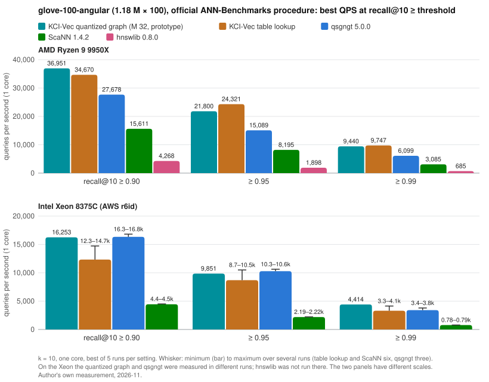

# KCI-Vec

自分のアプリの中で動く、ベクトル検索のライブラリです。文書や画像の中から、意味の近いものを探します。
検索サーバーは立てません。データは自分の機械の外に出ません。保存するファイルは暗号化できます。

> このリポジトリは、配布物 (Python の wheel。Linux x86-64、Windows x86-64、macOS) の置き場です。wheel は [Releases](https://github.com/KimYuki3/kci-vec-dist/releases) にあります (最新: [v0.2.20](https://github.com/KimYuki3/kci-vec-dist/releases/tag/v0.2.20)。各ファイルの sha256 は release の説明にあります)。ソースは [kci-vec-src](https://github.com/KimYuki3/kci-vec-src) です。

*[English](README.md)*

| | |
|---|---|
| 形 | C のファイル 1 つ (`kci_vec.c` + `kci_vec.h`)。ほかのライブラリに依存しません。Python からも呼べます |
| 向く場面 | 社内のシステム、手元の端末、製品に組み込む検索。データを外のサービスに預けられない所 |
| 大きさの目安 | 数万〜数百万件。探すのは 1 次元 1 バイトの行の上です。既定では、上位の候補を正確に比べ直すために float のベクトルも持ちます。`rerank=0` にすると 1 バイトの行だけになり、メモリは float の約 4 分の 1 ですが、取りこぼしが増えます |
| いまの版 | 0.2.20 (2026-11-28)。版ごとの変更は [配布のページ](https://github.com/KimYuki3/kci-vec-dist/releases)。評価用の配布物 (wheel) は [kci-vec-dist](https://github.com/KimYuki3/kci-vec-dist) |
| 段階 | 研究段階です。数字はすべて開発者自身の計測で、第三者の確認はまだ受けていません |

## 最初の 10 分: 文章を入れて、質問する

ベクトル検索の仕組みを、数式なしで説明した読み物があります: [やさしい解説「ベクトル検索は、どこで時間を使っているのか」](https://claude.ai/artifact/ConVBGLKGL9sK5XjJLDvfY)。

ベクトルやモデルのことを知らなくても始められます。文章を渡すと、中でベクトルに変えて索引を作ります。

```python
from kci_vec.text import TextIndex

ix = TextIndex("ja", sparse="bm25")
ix.add([
    "有給休暇は入社半年後に10日付与されます。申請は3営業日前までに上長へ。",
    "経費の精算は月末締めです。領収書の原本を総務に提出してください。",
    "パスワードを忘れたときは、情報システム課の内線1234に連絡してください。",
])
for hit in ix.search("有給は何日もらえますか", k=2):
    print(hit.id, round(hit.score, 3), hit.text)

ix.save("my_index", key="合言葉")          # 索引も本文も暗号化して保存
```

入れる所から、自分のファイルを入れて保存し、開き直して質問する所までの手順は
**[docs/quickstart_text_ja.md](https://github.com/KimYuki3/kci-vec-src/blob/main/docs/quickstart_text_ja.md)** にあります (まっさらな環境で、上から順に打って確かめた手順です)。
この層 (`kci_vec.text`) は実験的です。言語モデルを使う形で動かして確かめたのは Linux だけです。Windows と macOS では、モデルを使わない設定 (`mode="sparse", sparse="bm25"`) だけを確かめています。

自分でベクトルを用意する使い方は、下の「使い方」にあります。

## できること

| できること | 一言 | 段階 |
|---|---|---|
| 近いベクトルを探す | cosine・ユークリッド (L2)・内積。グラフをたどる方式と、かたまりに分けて調べる方式の 2 つ | 安定 |
| 作ったあとの追加・削除・詰め直し | どちらの方式でも | 安定 |
| 絞り込み検索 | 属性や権限で、探す途中に絞る (あとから削る形ではない) | 安定 |
| 暗号化した保存 | AES-256-CTR、改ざんは CMAC で検出。鍵違い・壊れたファイルは読み込まない | 安定 |
| 文章を渡すだけで探す | `kci_vec.text`。長い文章は自動で分ける。日本語と英語の既定のモデルつき | 実験的 |
| 言葉の一致と合わせて探す | 意味の検索 + 言葉の一致 (BM25 やスパースのモデル)。品番・人名・略語を落とさない | 実験的 |
| 並べ直しを差し込む | 候補を取り出して、自分の並べ直しのモデルに渡す口 | 実験的 |
| 同じベクトルをまとめて持つ | 同じ文が何度も入るデータ向け (`kci_vec_set_dedup`) | 安定 |
| PostgreSQL から使う | 拡張 `pg/`。SQL の関数で呼ぶ | 試作 |
| いくつものプロセスで索引を共有 | 読み取り専用の像を mmap で開く | 安定 |

方式の系統は、グラフが HNSW、かたまりに分ける方式が ScaNN や faiss fast-scan と同じ「4 ビットの符号と表引き」です。

## 向かない場面と、制限

先に書いておきます。当てはまるなら、ほかの道具のほうが合います。

- **運用を任せたい場合。** KCI-Vec は部品です。伸び縮みするサーバー、複数台への分散、管理画面はありません。
- **メモリに載らない大きさ。** 索引はメモリの上で探します。SSD に置いたまま探す方式 (DiskANN 系) はまだありません。
- **質問に文章で答えさせたい場合。** 返すのは「近いもの」までです。答えの文章を作るモデルは別に用意します。
- 書き込みは 1 本ずつです。探している最中に索引を変える使い方は、Python の層か PostgreSQL の拡張を通してください。
- 量子化グラフ (グラフ方式を速くする形) は、追加すると作り直しが要ります。
- L2 と内積の索引は、長さが飛び抜けたベクトルが混じると全体の見積もりが粗くなります。長さのそろったデータ向きです。
- まったく同じベクトルが多いデータは、そのままだとグラフ方式の recall が下がります。`kci_vec_set_dedup` を使ってください (0.2.8 から)。
- `kci_vec_set_dedup` を指定した索引と、メモリを先にした量子化グラフ (`kci_vec_build_qg_res`) の索引を保存したファイルは、0.2.7 までの版では読めません (読み込みを断ります)。
- ARM は素の C の道が中心で、x86 より遅くなります。
- 配っている Python の部品 (wheel、0.2.16 から): Linux x86-64 (AVX2。AVX-512 があれば使う)、Windows x86-64 (AVX2)、macOS (Apple シリコン、AVX2 のある 2013 年以降の Intel の Mac)。Windows と Intel の Mac の部品は AVX2 用の 1 種類だけです。AVX2 の無い Intel の Mac は確かめずに落ちます。macOS の部品は、借りた組み立て用の機械で作って試したもので、手元の Mac では確かめていません。

## 測った結果

**すべて開発者自身の計測です。** 相手は公式の設定のまま、KCI-Vec の設定は結果を見ながら選んだものを含みます。
データ・次元・機械で順位は変わります。

glove-100 (118 万件 × 100 次元)、公式 ANN-Benchmarks の手順、1 コア、recall@10 が 0.90 / 0.95 / 0.99 以上での最良 QPS:

| | Intel Xeon 8375C | AMD Ryzen 9 9950X |
|---|---|---|
| KCI-Vec グラフ方式 | 16,253 / 9,851 / 4,414 | 36,951 / 21,800 / 9,440 |
| KCI-Vec かたまりの方式 | 12,331〜14,725 / 8,694〜10,493 / 3,302〜4,138 | 34,670 / 24,321 / 9,747 |
| qsgngt 5.0.0 | 16,339〜16,809 / 10,282〜10,618 / 3,408〜3,789 | 27,678 / 15,089 / 6,099 |
| ScaNN 1.4.2 | 4,438〜4,508 / 2,190〜2,219 / 783〜794 | 15,611 / 8,195 / 3,085 |



VIBE (いまの埋め込みモデルのデータでのベンチマーク) の流れ、k = 100、1 コア、9950X、recall@100 が 0.90 / 0.95 / 0.99 以上での最良 QPS
(KCI-Vec は 0.2.5、glass は同じ機械で 2026-11-19 に測ったもの):

| | yahoo (cosine、384 次元) | agnews (L2、1024 次元) |
|---|---|---|
| KCI-Vec グラフ方式 | 21,294 / 18,197 / 12,139 | 13,619 / 9,649 / 5,982 |
| glass | 14,860 / 11,892 / 8,874 | 9,877 / 7,378 / 4,961 |

- Xeon の glove-100 では、qsgngt と 0.90・0.95 で並ぶか少し下、0.99 で上です。
- agnews は 0.2.3 からの値です。0.2.2 までは、0.95 から上で glass に届いていませんでした。
- KCI-Vec の索引は、この 2 つのデータで glass より大きくなります (上の点で、yahoo は 4.9〜5.0 GB に対し 0.7〜0.8 GB、agnews は 5.0〜7.4 GB に対し 2.5〜3.6 GB)。
  0.2.8 で、メモリを先にした形を足しました (VIBE の流れではまだ測っていません)。
- 届いていない所もあります。たとえば glove-200 では、どちらの方式も recall 0.99 に届きませんでした。
- PostgreSQL の中での pgvector との比べは、下の「PostgreSQL から使う」にあります。
- 順位表への登録: VIBE に申し込み中です ([PR #21](https://github.com/vector-index-bench/vibe/pull/21)。返事はまだありません)。ANN-Benchmarks は保守が止まっているので、申し込みを取り下げました。

## 使い方

### 入れる

```sh
# Python (Linux x86-64、Windows x86-64、macOS): 配っている部品
pip install kci-vec

# ソースから
sh build_kci_vec.sh          # libkci_vec.{so|dylib} と example_kci_vec   (Linux / macOS)
# Windows: gcc -O3 -march=native -shared -static -static-libgcc -o libkci_vec.dll kci_vec.c
# Python:  pip install ./clients/python
```

### Python (自分でベクトルを用意する)

```python
from kci_vec import KciVec

v = KciVec(dim=384, rerank=200)          # L2 は metric="l2"、内積は metric="ip"
v.add_many(ids, embeddings)              # float32 [n, dim]
v.build_lists()                          # かたまりの方式 (v.build() ならグラフ方式)
for doc_id, score in v.search(query_vec, k=5):
    ...
hits = v.search(query_vec, k=5, filter=allowed_ids)   # 絞り込み
v.save("index.kv", key=b"secret")        # 暗号化して保存
```

### C

```c
KciVec *v = kci_vec_new(dim, /*M*/16, /*efc*/200);      // L2: kci_vec_new_l2、内積: kci_vec_new_ip
kci_vec_add(v, id, float_vec);
kci_vec_build(v, /*threads*/0, &secs);                   // グラフを作る (0 = 全コア)
kci_vec_search(v, query, k, /*ef*/100, out_ids, out_scores);
kci_vec_save(v, "index.kv", key, keylen);                // 鍵を渡せば暗号化 (NULL で平文)
KciVec *v2 = kci_vec_load("index.kv", key, keylen);
kci_vec_free(v);
```

速さが要るときは、スレッドごとに `KciVecSearcher` を作って使い回します。一通りの流れは `example_kci_vec.c`、関数の説明は `kci_vec.h` の宣言の上にあります。

### PostgreSQL から使う (拡張 `pg/`、試作)

```sql
SELECT kci_vec_build('docs', 'docs', 'id', 'embedding');            -- 表 docs(id, embedding) から索引を作る
SELECT kci_vec_track('docs');                                        -- 以後の INSERT / UPDATE / DELETE を追う
SELECT id, score FROM kci_vec_search('docs', '[0.1, ...]'::vector, 10);
```

- サーバー・権限・バックアップ・複製は PostgreSQL のものをそのまま使えます。表の更新は検索にすぐ反映されます。
- 距離は cosine・L2・内積。PostgreSQL 15 / 16 / 17 で試験しています。
- pgvector と同じ書き方ではありません (`CREATE INDEX` と `<=>` ではなく、関数で呼びます)。
- 自分で管理する PostgreSQL 向けです。拡張を自由に入れられない管理型のサービスでは使えません。
- 拡張が持つ索引のファイルは、いまは暗号化していません (ディスクの暗号化と一緒に使ってください)。

同じ機械・同じ表・同じ SQL の往復での、pgvector 0.8.1 (HNSW、m 16、ef_construction 200) との比べ
(glove-100 の 118 万行、1 接続、k = 10、交互に 3 巡、Ryzen 7 8845HS、PostgreSQL 16、2026-11-20):

| | recall@10 | 問/秒 |
|---|---|---|
| KCI-Vec | 0.9005 | 3,261〜3,906 |
| pgvector (ef_search 240) | 0.8947 | 199〜210 |
| KCI-Vec | 0.9632 | 1,776〜2,206 |
| pgvector (ef_search 1000、上限) | 0.9612 | 58〜59 |

1 つのデータ・1 台の機械での値です。同時接続と絞り込みは測っていません。使い方と制限は `pg/README_ja.md`。

## 暗号と検査

- 暗号は標準の方式だけです。AES-256-CTR、AES-256-CMAC、鍵は PBKDF2-HMAC-SHA256 と保存ごとのソルトから作ります。
  AES と CMAC は FIPS-197・SP 800-38B の既知の答えで確かめています。
- 復号するのは読み込むときだけなので、検索の速さは暗号化しない場合と変わりません。
- 鍵違い・壊れたファイル・書き換えられたファイルは読み込みません。保存は一時ファイルから名前を付け替えるので、途中で落ちても壊れません。
- 検査: 悪意のある入力と 32 スレッドの同時負荷で ASan / UBSan の報告 0。

## ソース

C のソース、Python の包み、PostgreSQL の拡張、試験、手順書は [kci-vec-src](https://github.com/KimYuki3/kci-vec-src) にあります。

## ライセンス

[MIT](LICENSE) (版 0.2.15 から): 商用の製品への組み込みを含めて、無償で使う・変える・配ることができます。
0.2.14 までの版は PolyForm Noncommercial 1.0.0 で公開したもので、そのライセンスのままです。

Copyright (c) 2026 Yukihiro Kimura (https://github.com/KimYuki3)

ユークリッド距離を cosine の索引に写す方法は、特許出願中です (特願2026-241178)。この表示は、その方法だけについてのものです。
